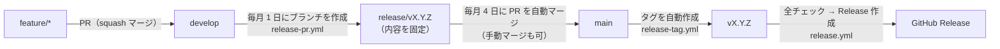

# リリースワークフロー

リリースは月 1 回、自動で行われます。**日々の作業は `develop` への PR だけ**です。

- **毎月 1 日 09:00 JST**: `develop` の先端から `release/vX.Y.Z` ブランチを切り、`main` への
  リリース PR が自動で作られます（内容とリリースノートを確認する期間）。
- **毎月 4 日 09:00 JST**: その PR が自動でマージされ、タグ付け・検証・GitHub Release の作成まで進みます。

リリース対象は**リリースブランチに固定される**ので、確認している間に `develop` へマージされた
変更が入り込むことはありません（その変更は次回のリリースに回ります）。
リリースする差分が無ければどちらの日も何もしません。すぐリリースしたいときは、リリース PR を
手でマージすれば同じ流れが動きます。

日々の開発フローについては [development_workflow.md](./development_workflow.md) を参照してください。

## 0. 全体像



| ワークフロー | いつ動くか | 何をするか |
| :--- | :--- | :--- |
| [release-pr.yml](../.github/workflows/release-pr.yml)（`prepare` ジョブ） | 毎月 1 日 09:00 JST / 手動実行 | 次のバージョンを算出し、`release/vX.Y.Z` を切って `main` へのリリース PR を作る |
| [release-pr.yml](../.github/workflows/release-pr.yml)（`release` ジョブ） | 毎月 4 日 09:00 JST / 手動実行 | リリース PR をマージしてリリースを開始し、リリースブランチを削除する |
| [release-tag.yml](../.github/workflows/release-tag.yml) | `main` への push（自動マージ時は手動起動） | バージョンタグを作成し、リリースを起動する。`hotfix` の場合は `develop` への追従 PR も作る |
| [release.yml](../.github/workflows/release.yml) | タグに対して | 全チェック（`make check`）を実行し、通ったら GitHub Release を作成する |

## 1. バージョニング方針（コミットメッセージで決まる）

リポジトリ単位でセマンティックバージョニングを行います。利用者はモジュールを
`?ref=<タグ>` で参照するため、タグは**不変**として扱います。

バージョンの上げ方は、前回のリリース以降のコミットメッセージから自動で判定します。

| 種別 | 判定条件 | 対象となる変更 |
| :--- | :--- | :--- |
| MAJOR | `feat(scope)!: ...` のように type の後ろに `!` を付ける／本文に `BREAKING CHANGE:` を書く | 変数の削除・リネーム・必須化、リソースの再作成やダウンタイムを伴う変更 |
| MINOR | `feat` のコミットがある | 後方互換のある機能追加（`optional` 変数の追加、出力の追加、新モジュール） |
| PATCH | 上記以外のコミット（`fix` / `docs` / `chore` など） | バグ修正、ドキュメント修正 |

- **破壊的変更を含む PR では、タイトルに `!` を付けてください**（例:
  `feat(modules/google/postgres-psc)!: database_flags の型を変更`）。`develop` へのマージは
  squash なので、PR タイトルがそのままコミットの subject になり、判定に使われます。
- 次のバージョンはローカルでも確認できます。

  ```bash
  make next-version REF=origin/develop
  ```

- 判定ロジックは [scripts/next-version.py](../scripts/next-version.py) にあり、
  `make test-scripts` でテストしています。
- **リリースタグが 1 つも無い場合は、判定に関わらず `v1.0.0`** になります
  （`scripts/next-version.py` の `FIRST_VERSION`）。初回だけは `level` を指定しても変わりません。

破壊的変更の判定基準と、`moved` ブロックによる state 移行については
[module_contribution_guidelines.md](./module_contribution_guidelines.md) の
「8. 後方互換性とリリース」を参照してください。

## 2. リリースの手順

1. **`develop` に PR をマージする**（通常の開発）。ここでは何も起きません。

2. **毎月 1 日に `release/vX.Y.Z` が切られ、「Release vX.Y.Z」の PR が自動で作られます**
   （`release/vX.Y.Z` → `main`）。内容を確認してください。
   **リリース対象はこのブランチに固定される**ので、確認中に `develop` へマージされた変更は
   この PR に入りません（次回のリリースに回ります）。
   - バージョンの上げ方（MAJOR / MINOR / PATCH）とその判定根拠が本文に載ります。
   - リリースノートのプレビュー（PR のタイトルとラベルから生成）が載ります。
   - 破壊的変更がある場合は、本文の「破壊的変更の移行手順」欄に移行手順を書いてください。
     **ここに書いた内容はリリースノートの先頭に転記されます。**
     欄の外に書いた内容も残ります（自動更新されるのはマーカーで囲まれた範囲だけです）。

3. **毎月 4 日に自動でマージされます。** すぐリリースしたい場合は、
   「Create a merge commit」で手でマージしてください。

   > [!WARNING]
   > **Squash and merge は使わないでください。** `main` と `develop` の履歴が分岐し、
   > 次回以降のバージョン算出とリリースノートが壊れます。

4. **あとは自動**です。
   1. `main` への push で [release-tag.yml](../.github/workflows/release-tag.yml) が
      `vX.Y.Z` のタグを作成します（PR タイトルのバージョンを使います）。月次の自動マージの場合は、
      GITHUB_TOKEN のマージでは push イベントが発火しないため release-pr.yml が
      release-tag.yml を直接起動します。
   2. タグに対して [release.yml](../.github/workflows/release.yml) が動き、
      `make check`（fmt・規約・validate・test・tflint・trivy）を実行します。
   3. チェックが通ると GitHub Release が作成されます。リリースノートは
      「移行手順 → 利用方法（`?ref=` 付きのコード例）→ 変更内容」の順で構成されます。
   4. タグを打った旨がリリース PR にコメントされます。

### 月次の自動リリース

「リリースするのを忘れる」を無くすための仕組みです。リリース PR は**リリースの周期に合わせて
作られます**（`develop` にマージしたタイミングでは作られません）。

| いつ | 何が起きるか |
| :--- | :--- |
| 毎月 1 日 09:00 JST | 差分があれば `release/vX.Y.Z` を切ってリリース PR を作る（差分が無ければ何もしない。既にリリース PR が開いている場合は作り直さない） |
| 毎月 4 日 09:00 JST | リリース PR をマージしてリリースを開始し、リリースブランチを削除する |

4 日のマージは、次のいずれかに当てはまると **見送り**になります。リリース PR に理由がコメントされ、
ワークフローは失敗しません。

| 状況 | 動き |
| :--- | :--- |
| リリースする差分が無い | 何もしない（リリース PR も作られない） |
| **破壊的変更（MAJOR）を含む** | **見送り**。作成時に `breaking-change` ラベルが付き、自動マージの対象外になる。移行手順を追記し、内容を確認して人がマージする |
| CI が失敗 / 実行中、コンフリクトあり、`main` が先に進んでいる | 見送り。原因を解消して PR をマージする |
| `release-hold` ラベルが付いている | 見送り。ラベルを外せば次回から対象になる |
| ブランチ保護でレビューが必須 | 見送り。内容を確認して手でマージする |

- 見送られた場合も、原因を解消してリリース PR をマージすれば通常どおりリリースされます。
  翌月まで待つ必要はありません。
- **リリース直前に修正を入れたい場合**は、リリースブランチに直接コミット（または cherry-pick）して
  push してください。CI が走り、マージ後は `main` → `develop` の追従 PR が自動で作られます。
  機能追加は入れず、次回のリリースに回してください（バージョンはブランチ名で固定されています）。
- **初回だけは手でマージしてください。** GitHub の仕様で、`schedule` と `workflow_dispatch` は
  既定ブランチ（`main`）にあるワークフローしか動きません。`release-pr.yml` が `main` に
  取り込まれた（＝1 回目のリリースが済んだ）あとから月次実行と手動実行が有効になります。
- **今すぐリリースしたい**ときは、リリース PR をマージしてください。リリース PR がまだ無い場合は、
  Actions の **Release PR** ワークフローを実行するとリリースブランチと PR が作られます
  （`release: true` にすると作成からマージまで一度に行います）。
- **今月はリリースしたくない**ときは、リリース PR に `release-hold` ラベルを付けてください
  （PR は残るので、あとで気が変わったら手でマージできます）。PR を閉じてしまうと、次に作られるのは
  翌月 1 日になります。

### バージョンを自分で決めたい場合

Actions の **Release PR** ワークフローを `workflow_dispatch` で実行し、`level` に
`major` / `minor` / `patch` を指定するとリリース PR のバージョンが更新されます。
（例: 実装は `fix` だけだが、利用者への影響が大きいので MINOR にしたい場合）

### プレリリース

`v1.2.0-rc.1` のようなタグを手で push すると、release.yml が prerelease として公開します。
自動フローの対象外（バージョン算出でも無視されます）なので、必要なときだけ使ってください。

> [!NOTE]
> プレリリースのタグも **`main` に含まれるコミットに打つ必要があります**。release.yml が
> タグの `main` 到達性を検証するため、`develop` のコミットに rc タグを打つと失敗します。

## 3. うまくいかなかったとき

| 症状 | 対処 |
| :--- | :--- |
| リリース PR が作られない | `develop` の変更がすべて `main` に入っている（リリースする差分が無い）状態です。Actions の実行サマリーに理由が出ます。 |
| タグは作られたが Release が作られない | `make check` が失敗しています。`maintenance` ラベルの Issue が自動で作られ、リリース PR にもコメントが付きます。**タグは打ち直さず**、修正を `develop` → `main` に入れて次のパッチバージョンをリリースしてください。 |
| 誤って Squash マージしてしまった | `main` と `develop` の履歴が分岐します。release-tag.yml が検知して `main` → `develop` の追従 PR を作るので、それをマージして履歴を戻してから次のリリースに進んでください。 |
| バージョンが期待と違う | コミットの type が判定に合っていません。リリース PR を `workflow_dispatch` の `level` 指定で作り直せます。 |
| 月次リリースが「見送り」とコメントした | コメントに理由が書かれています（破壊的変更 / CI 失敗 / コンフリクト / `release-hold` / ブランチ保護）。解消してリリース PR をマージすればリリースされます。 |
| リリース PR が作られない（差分はある） | リリース PR は毎月 1 日にしか作られません（既に開いているリリース PR がある場合も作られません）。待てない場合は Actions の **Release PR** を手動実行してください。 |
| リリースブランチが残っている | マージ時に自動削除されますが、失敗した場合は残ります。手で削除して構いません（次回は新しく切り直します）。 |
| 「`release/vX.Y.Z` が別のコミットを指しています」で失敗した | 同名の古いリリースブランチが残っています。内容を確認して削除し、Actions の **Release PR** を再実行してください（古いブランチでリリース PR を作らないよう、自動では上書きしません）。 |
| `main` にマージ済みなのにタグ / Release が無い | 自動リリースが途中で中断した場合です。[release-tag.yml](../.github/workflows/release-tag.yml) の日次実行が翌日に自動で回復します。待てない場合は Actions の **Release Tag** を `main` に対して手動実行してください（既存のタグは打ち直しません）。 |

> [!IMPORTANT]
> 利用者は `source = "...?ref=v1.2.0"` の形でタグを参照します。
> **公開済みのタグを打ち直さないでください。** 利用者の `terraform init` の
> キャッシュ状況によって取得内容が変わり、原因の追いにくい差分を生みます。
> 修正が必要な場合は新しいパッチバージョンをリリースしてください。

## 4. 緊急修正フロー (`hotfix`)

`develop` の変更を待てない修正は、`main` から `hotfix` ブランチを切ります。

```bash
git checkout main
git pull origin main
git checkout -b hotfix/fix-critical-bug
# 修正して push
gh pr create --base main --head hotfix/fix-critical-bug --title "fix(modules/google/external-lb): 証明書の依存順序を修正"
```

`main` にマージすると、自動で次が行われます。

1. コミットメッセージからバージョンを算出してタグを作成（通常はパッチバージョン）
2. 全チェックののち GitHub Release の作成
3. **`main` の変更を `develop` に取り込む PR の作成**（マージコミットでマージしてください）

## 5. リポジトリ設定の前提

この自動化には、GitHub 側の設定が必要です（コードだけでは設定できません）。

### Actions（必須）

**Settings > Actions > General > Workflow permissions**

- `Read and write permissions`
- `Allow GitHub Actions to create and approve pull requests` を有効にする
  （リリース PR と `develop` 追従 PR の作成に必要）

### マージ方法（必須）

**Settings > General > Pull Requests** の設定はリポジトリ全体に効きます（ブランチ単位ではありません）。

- **`Allow merge commits` と `Allow squash merging` の両方を有効にしておきます。**
  リリース PR は merge commit で、`develop` への PR は squash でマージするためです。
  月次の自動マージは merge commit を使うので、merge commit を無効にすると常に失敗します。
- ブランチごとの強制は下記のルールセットで設定済みです（`main` は merge commit のみ、
  `develop` は squash と merge commit）。`develop` で merge commit を許しているのは、
  `hotfix` のあとに作られる `main` → `develop` の追従 PR がマージコミットである必要が
  あるためです。
- **`main` に `Require linear history` を設定しないでください**（merge commit が禁止され、
  リリースがマージできなくなります）。

### ブランチとタグの保護（設定済み）

**Settings > Rules > Rulesets** に 3 つのルールセットが `Active` で入っています。
どれも bypass actor を設定していないので、管理者にも Actions にも同じように効きます。

| ルールセット | 対象 | 内容 |
| :--- | :--- | :--- |
| `tags-v-immutable` | `refs/tags/v*` | 更新と削除を禁止（作成は許可） |
| `main` | `refs/heads/main` | PR 必須（レビュー 0 人）、削除と force push を禁止、マージ方法は merge commit のみ |
| `develop` | `refs/heads/develop` | PR 必須（レビュー 0 人）、削除と force push を禁止、マージ方法は squash と merge commit |

- **タグの更新・削除禁止**が、このリポジトリでいちばん重要な保護です。利用者は `?ref=<タグ>`
  で参照するため、公開済みのタグを打ち直すと利用者の `terraform plan` の結果が黙って変わります。
  作成は許可しているので、[release-tag.yml](../.github/workflows/release-tag.yml) の
  タグ付けはそのまま動きます。
- **`main` をレビュー必須にしていません。** レビュー必須にすると月次の自動マージが常に
  見送られます（リリース PR にコメントが付き、人がマージすることになります）。
  レビューは [CODEOWNERS](../.github/CODEOWNERS) による依頼で運用します。
- **PR 必須にしているのは、`main` への直接 push がそのままリリースになるためです**
  （`release-tag.yml` が push を検知してタグを打ちます）。
- `release/*`: 保護は不要です。リリース PR の head は `release/vX.Y.Z` で、マージ後に
  [release-pr.yml](../.github/workflows/release-pr.yml) が自分で削除します。
  **消し忘れて古いリリースブランチが残っていると、次のリリース PR の作成が止まります**
  （同名のブランチを勝手に上書きしないため）。その場合は内容を確認して手で削除してください。
- `Automatically delete head branches`（Settings > General）を有効にすると、`feature/*` の
  後片付けが不要になります。`develop` が head になる PR は無いので、この設定で `develop` が
  消えることはありません（リリース PR の head は `release/vX.Y.Z`、`hotfix` の追従 PR の
  head は `main` です）。

### Required status checks（任意）

GITHUB_TOKEN で作られた PR では `pull_request` のワークフローが起動しないため、リリース PR に
対して CI は直接走りません。ただし `develop` への push で **同じコミットに対して**
CI（[ci.yml](../.github/workflows/ci.yml)）が実行されるため、その結果がリリース PR 上の
チェックとして表示されます。

Required checks に指定する場合は、実際のチェック名を選んでください。

- `規約チェック`
- `tflint`
- `セキュリティスキャン`
- `validate & test (terraform <最小バージョン>)` … 名前に
  [`.tool-versions`](../.tool-versions) の Terraform バージョンが入ります。
  **バージョンを上げたら Required checks の名前も更新してください。**
- `validate & test (terraform latest)`

リリース対象のコミットは、タグ付け後に release.yml が `make check` で改めて検証します
（失敗した場合は `maintenance` ラベルの Issue が自動で作られます）。

> [!NOTE]
> 以前は `CHANGELOG.md` と `release/*` ブランチを管理していましたが、現在はどちらも
> 使いません。変更履歴は GitHub Releases のリリースノートに一元化し、リリース準備は
> 自動作成されるリリース PR が担います。
