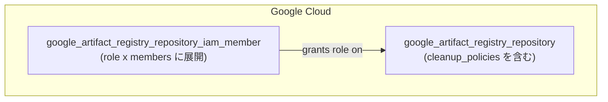

# Artifact Registry Module

Artifact Registry のリポジトリと、そのリポジトリに対する IAM 付与・クリーンアップポリシーを
1 つのモジュールコールで構築します。

## なぜこのモジュールを使うのか

Artifact Registry を実運用に乗せるには、リポジトリ本体のほかに「誰が pull / push できるか」の
IAM 付与と、イメージが無限に増え続けないためのクリーンアップポリシーが必要です。
これらは別リソース・別 API 制約を持つため、素の `resource` で書くと定型コードが分散します。

このモジュールは、

- `role` × `members` のリストを IAM メンバーへ自動展開する
- クリーンアップポリシーの「`condition` と `most_recent_versions` は同時に指定できない」という
  API 制約を `validation` で apply 前に検出する
- `docker push` にそのまま使えるホスト付きパスを出力する

ことで、リポジトリ 1 つ分の設定をまとめて扱えるようにしています。

## 構成リソース



## 使い方

利用パターンの詳細・プライベートリポジトリの認証・アップグレード手順は
[docs/module_usage.md](../../../docs/module_usage.md) を参照してください。

### パターン A: GitHub 参照

```hcl
module "artifact_registry" {
  source = "git::https://github.com/kotaitos/terraform-modules.git//modules/google/artifact-registry?ref=main"

  environment = {
    project_id = "my-project-id"
  }

  repository = {
    repository_id = "my-docker-repo"
    format        = "DOCKER"
    location      = "asia-northeast1"
    description   = "Docker container registry"
  }
}
```

### パターン B: コピー＆ペースト

`modules/google/artifact-registry` をディレクトリごと案件リポジトリの `modules/artifact-registry`
にコピーし、ローカルパスで参照します。

```hcl
module "artifact_registry" {
  source = "./modules/artifact-registry"

  # 変数はパターン A と完全に同じ
  environment = {
    project_id = "my-project-id"
  }

  repository = {
    repository_id = "my-docker-repo"
    format        = "DOCKER"
    location      = "asia-northeast1"
  }
}
```

### フル構成の例

```hcl
module "artifact_registry" {
  source = "git::https://github.com/kotaitos/terraform-modules.git//modules/google/artifact-registry?ref=main"

  environment = {
    project_id = "my-project-id"
  }

  repository = {
    repository_id = "my-docker-repo"
    format        = "DOCKER"
    location      = "asia-northeast1"
    description   = "Docker container registry"

    # 本番反映前に、削除対象だけをログで確認したい場合は true
    cleanup_policy_dry_run = false

    docker_config = {
      # タグの上書きを禁止し、イメージの同一性を保証する
      immutable_tags = true
    }

    cleanup_policies = [
      # 最新 5 バージョンは常に残す
      {
        id     = "keep-recent-versions"
        action = "KEEP"
        most_recent_versions = {
          keep_count = 5
        }
      },
      # タグの付いていないイメージは 30 日で削除
      {
        id     = "delete-old-untagged"
        action = "DELETE"
        condition = {
          tag_state  = "UNTAGGED"
          older_than = "2592000s" # 30 days
        }
      },
    ]

    iam_role_members = [
      {
        role = "roles/artifactregistry.reader"
        members = [
          "serviceAccount:my-service-account@my-project-id.iam.gserviceaccount.com",
          "group:devs@example.com",
        ]
      },
      {
        role = "roles/artifactregistry.writer"
        members = [
          "serviceAccount:ci-cd@my-project-id.iam.gserviceaccount.com",
        ]
      },
    ]
  }

  labels = {
    environment = "production"
    app         = "my-app"
  }
}
```

## Inputs

| Name | Description | Type | Default | Required |
|------|-------------|------|---------|:--------:|
| environment | 環境設定。 | `object` | n/a | yes |
| repository | Artifact Registry リポジトリの設定。 | `object` | n/a | yes |
| labels | リポジトリに適用するラベル。 | `map(string)` | `{}` | no |

### `environment`

| Name | Description | Type | Default | Required |
|------|-------------|------|---------|:--------:|
| project_id | デプロイ先の Google Cloud プロジェクト ID。 | `string` | n/a | yes |
| project_name | プロジェクト名。このモジュールでは未使用（他モジュールとの互換のため受け取る）。 | `string` | `null` | no |
| region | リージョン。このモジュールでは未使用（リポジトリの場所は `repository.location` で指定）。 | `string` | `null` | no |
| stack_name | スタック名。このモジュールでは未使用。 | `string` | `null` | no |

### `repository`

| Name | Description | Type | Default | Required |
|------|-------------|------|---------|:--------:|
| repository_id | リポジトリ ID。小文字英数字とハイフン、63 文字以内。 | `string` | n/a | yes |
| format | リポジトリのフォーマット (`DOCKER`, `MAVEN`, `NPM`, `PYTHON`, `APT`, `YUM`, `KFP`, `GO`, `GENERIC`)。 | `string` | n/a | yes |
| location | リポジトリのロケーション (例: `asia-northeast1`)。 | `string` | n/a | yes |
| description | リポジトリの説明。 | `string` | `null` | no |
| cleanup_policy_dry_run | `true` の場合、クリーンアップポリシーは削除を行わず対象のログ出力のみ行う。 | `bool` | `false` | no |
| kms_key_name | CMEK で暗号化する場合の Cloud KMS 鍵の完全修飾名。 | `string` | `null` | no |
| docker_config | Docker フォーマット固有の設定。 | `object` | `null` | no |
| cleanup_policies | クリーンアップポリシーのリスト。 | `list(object)` | `[]` | no |
| iam_role_members | ロールと付与先メンバーの組のリスト。 | `list(object)` | `[]` | no |

### `repository.docker_config`

| Name | Description | Type | Default | Required |
|------|-------------|------|---------|:--------:|
| immutable_tags | `true` に設定すると、タグの上書きを禁止する。 | `bool` | `false` | no |

### `repository.cleanup_policies[*]`

`condition` と `most_recent_versions` は**どちらか一方のみ**を指定します（API の制約）。
両方指定した場合・どちらも指定しなかった場合は `terraform plan` 時にエラーになります。

| Name | Description | Type | Default | Required |
|------|-------------|------|---------|:--------:|
| id | ポリシーの ID。リポジトリ内で一意。 | `string` | n/a | yes |
| action | `KEEP` または `DELETE`。 | `string` | n/a | yes |
| condition | 対象バージョンの条件。 | `object` | `null` | no |
| most_recent_versions | 直近 N バージョンを対象にする指定。 | `object` | `null` | no |

### `repository.cleanup_policies[*].condition`

| Name | Description | Type | Default | Required |
|------|-------------|------|---------|:--------:|
| tag_state | `TAGGED`, `UNTAGGED`, `ANY`。 | `string` | `null` | no |
| tag_prefixes | 対象とするタグのプレフィックス。 | `list(string)` | `null` | no |
| version_name_prefixes | 対象とするバージョン名のプレフィックス。 | `list(string)` | `null` | no |
| package_name_prefixes | 対象とするパッケージ名のプレフィックス。 | `list(string)` | `null` | no |
| older_than | この期間より古いバージョンを対象にする (例: `"2592000s"`)。 | `string` | `null` | no |
| newer_than | この期間より新しいバージョンを対象にする。 | `string` | `null` | no |

### `repository.cleanup_policies[*].most_recent_versions`

| Name | Description | Type | Default | Required |
|------|-------------|------|---------|:--------:|
| keep_count | 保持する最新バージョン数。 | `number` | `null` | no |
| package_name_prefixes | 対象とするパッケージ名のプレフィックス。 | `list(string)` | `null` | no |

### `repository.iam_role_members[*]`

| Name | Description | Type | Default | Required |
|------|-------------|------|---------|:--------:|
| role | IAM ロール (例: `roles/artifactregistry.reader`)。 | `string` | n/a | yes |
| members | 付与先メンバー。`serviceAccount:` / `group:` / `user:` などの接頭辞が必須。 | `list(string)` | n/a | yes |

## Outputs

| Name | Description |
|------|-------------|
| repository | 作成された Artifact Registry リポジトリのリソース全体。 |
| repository_id | リポジトリ ID (例: `my-docker-repo`)。 |
| id | リポジトリの Terraform リソース ID。 |
| name | リポジトリの完全修飾名 (`projects/../locations/../repositories/..`)。 |
| location | リポジトリのロケーション。 |
| docker_repository_url | `DOCKER` フォーマットの場合の `docker push` 用ホスト付きパス。それ以外は `null`。 |

## Requirements

| Name | Version |
|------|---------|
| terraform | >= 1.10 |
| google | >= 6.0.0, < 8.0.0 |

## Notes

- IAM は authoritative でない `google_artifact_registry_repository_iam_member` を使っています。
  このモジュールの管理外で付与されたバインディングは削除されません。
- `iam_role_members` の for_each キーは `"<role>:<member>"` です。ロールやメンバーの文字列を
  変更すると、該当バインディングは削除 → 再作成になります（ロール自体は冪等なため実害はありません）。
- `cleanup_policies` を後から削除しても、Artifact Registry 側に残ったポリシーは
  Terraform が削除します。一時的に停止したいだけの場合は `cleanup_policy_dry_run = true` を使ってください。

## 既存構成からのアップグレード

| 変更 | plan に現れる内容 | 理由 |
| :--- | :--- | :--- |
| `labels` がリポジトリに反映されるようになった | リポジトリの**インプレース更新** | 以前は `labels` 変数が宣言されているだけで未使用だった（バグ修正） |
| `action` が大文字に正規化されるようになった | 小文字で指定していた場合はインプレース更新 | API の期待値に合わせるため |

### 主な機能追加

- `cleanup_policies` の `condition` / `most_recent_versions` が `optional` になり、
  **片方だけを指定するポリシーが書けるようになった**（以前は両方を必ず渡す必要があり、
  「直近 N 件を残す」だけのポリシーが表現できなかった）
- `cleanup_policies` / `iam_role_members` / `description` / `labels` を省略できるようになった
- `cleanup_policy_dry_run`、`kms_key_name` の追加
- `docker_repository_url` 出力の追加（`docker push` にそのまま使える）
- `validation` による事前チェック（フォーマットの列挙値、ポリシー ID の重複、
  `condition` と `most_recent_versions` の排他など）
