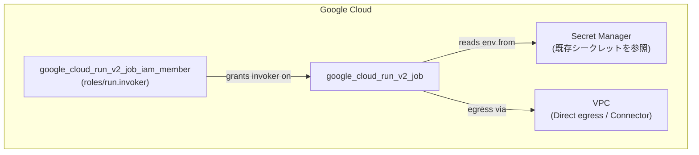

# Cloud Run Job Module

バッチ処理向けの Cloud Run v2 Job を、環境変数・Secret Manager 参照・VPC 接続・実行権限まで
含めて 1 つのモジュールコールで構築します。

## なぜこのモジュールを使うのか

`google_cloud_run_v2_job` は `template.template.containers` という 3 階層のネストを持ち、
素の `resource` で書くと環境変数や VPC 設定を追加するたびに `dynamic` ブロックが増えていきます。
また Cloud Scheduler から定期実行する構成では `roles/run.invoker` の付与が別リソースになります。

このモジュールは、

- 環境変数を「マップのキー = 環境変数名」で書けるようにし、`dynamic` ブロックを隠蔽する
- 平文の環境変数と Secret Manager 参照を同じ書き方で扱える
- Direct VPC egress と Serverless VPC Access コネクタの排他制約を `validation` で apply 前に検出する
- `invoker_members` を渡すだけで実行権限を付与できる

ことで、ジョブ 1 つ分の設定をまとめて扱えるようにしています。

## 構成リソース



> [!NOTE]
> Secret Manager のシークレット本体はこのモジュールでは作成しません。既存のシークレットを
> `secret_env_vars` で参照します。シークレットへの `roles/secretmanager.secretAccessor` は
> 別途付与してください（[service-accounts](../service-accounts) モジュールなどを利用できます）。

## 使い方

利用パターンの詳細・プライベートリポジトリの認証・アップグレード手順は
[docs/module_usage.md](../../../docs/module_usage.md) を参照してください。

### パターン A: GitHub 参照

```hcl
module "batch_job" {
  source = "git::https://github.com/kotaitos/terraform-modules.git//modules/google/cloud-run-job?ref=main"

  environment = {
    project_id = "my-project-id"
    region     = "asia-northeast1"
  }

  job = {
    name                  = "nightly-batch"
    image                 = "asia-northeast1-docker.pkg.dev/my-project-id/app/batch:v1"
    service_account_email = "batch-runner@my-project-id.iam.gserviceaccount.com"
  }
}
```

### パターン B: コピー＆ペースト

`modules/google/cloud-run-job` をディレクトリごと案件リポジトリの `modules/cloud-run-job`
にコピーし、ローカルパスで参照します。変数はパターン A と完全に同じです。

```hcl
module "batch_job" {
  source = "./modules/cloud-run-job"

  environment = {
    project_id = "my-project-id"
    region     = "asia-northeast1"
  }

  job = {
    name                  = "nightly-batch"
    image                 = "asia-northeast1-docker.pkg.dev/my-project-id/app/batch:v1"
    service_account_email = "batch-runner@my-project-id.iam.gserviceaccount.com"
  }
}
```

### フル構成の例

```hcl
module "batch_job" {
  source = "git::https://github.com/kotaitos/terraform-modules.git//modules/google/cloud-run-job?ref=main"

  environment = {
    project_id = "my-project-id"
    region     = "asia-northeast1"
  }

  job = {
    name                  = "nightly-batch"
    image                 = "asia-northeast1-docker.pkg.dev/my-project-id/app/batch:v1"
    service_account_email = "batch-runner@my-project-id.iam.gserviceaccount.com"

    command     = ["python"]
    args        = ["-m", "jobs.nightly"]
    timeout     = "1800s"
    max_retries = 3

    # 1 実行を 4 タスクに分割し、2 タスクずつ並列実行する
    task_count  = 4
    parallelism = 2

    resources = {
      cpu    = "2000m"
      memory = "2Gi"
    }

    # マップのキーがそのまま環境変数名になる
    env_vars = {
      LOG_LEVEL = { value = "info" }
      STAGE     = { value = "prod" }
    }

    # 既存の Secret Manager シークレットを環境変数として渡す
    secret_env_vars = {
      DB_PASSWORD = { secret_id = "db-password" }
      API_KEY     = { secret_id = "api-key", version = "3" }
    }

    # Direct VPC egress で VPC 内のリソース (Cloud SQL PSC など) に接続する
    vpc_access = {
      network    = "projects/my-project-id/global/networks/main"
      subnetwork = "projects/my-project-id/regions/asia-northeast1/subnetworks/main"
      egress     = "PRIVATE_RANGES_ONLY"
    }

    # Cloud Scheduler から実行させる
    invoker_members = [
      "serviceAccount:scheduler@my-project-id.iam.gserviceaccount.com",
    ]

    labels = {
      app = "batch"
    }
  }
}
```

## Inputs

| Name | Description | Type | Default | Required |
|------|-------------|------|---------|:--------:|
| environment | 環境設定。 | `object` | n/a | yes |
| job | Cloud Run Job の設定。 | `object` | n/a | yes |

### `environment`

| Name | Description | Type | Default | Required |
|------|-------------|------|---------|:--------:|
| project_id | デプロイ先の Google Cloud プロジェクト ID。 | `string` | n/a | yes |
| region | ジョブを作成するリージョン。 | `string` | n/a | yes |
| project_name | プロジェクト名。このモジュールでは未使用。 | `string` | `null` | no |
| stack_name | スタック名。このモジュールでは未使用。 | `string` | `null` | no |

### `job`

| Name | Description | Type | Default | Required |
|------|-------------|------|---------|:--------:|
| name | ジョブ名。小文字英字始まり、小文字英数字とハイフン、49 文字以内。 | `string` | n/a | yes |
| image | 実行するコンテナイメージ。 | `string` | n/a | yes |
| service_account_email | ジョブの実行に使うサービスアカウント。 | `string` | n/a | yes |
| container_name | コンテナ名。 | `string` | `"main"` | no |
| timeout | 1 タスクのタイムアウト (例: `"600s"`)。 | `string` | `"600s"` | no |
| max_retries | タスク失敗時の再試行回数。 | `number` | `0` | no |
| task_count | 1 実行あたりのタスク数。 | `number` | `1` | no |
| parallelism | 同時に実行するタスク数。`0` は Cloud Run 側の既定に任せる。 | `number` | `0` | no |
| deletion_protection | `true` の場合、Terraform からのジョブ削除をブロックする。 | `bool` | `true` | no |
| command | コンテナの ENTRYPOINT を上書きする。省略時はイメージの設定を使う。 | `list(string)` | `null` | no |
| args | コンテナの CMD を上書きする。省略時はイメージの設定を使う。 | `list(string)` | `null` | no |
| execution_environment | `EXECUTION_ENVIRONMENT_GEN1` または `EXECUTION_ENVIRONMENT_GEN2`。 | `string` | `"EXECUTION_ENVIRONMENT_GEN2"` | no |
| encryption_key | CMEK で暗号化する場合の Cloud KMS 鍵。 | `string` | `null` | no |
| resources | CPU / メモリの上限。 | `object` | `{}` | no |
| env_vars | 平文の環境変数。マップのキーが環境変数名になる。環境変数名は英字かアンダースコア始まり、英数字とアンダースコアのみ（ハイフン不可）。`env_vars` と `secret_env_vars` を通して一意であること。 | `map(object)` | `{}` | no |
| secret_env_vars | Secret Manager から取得する環境変数。マップのキーが環境変数名になる。環境変数名は英字かアンダースコア始まり、英数字とアンダースコアのみ（ハイフン不可）。`env_vars` と `secret_env_vars` を通して一意であること。 | `map(object)` | `{}` | no |
| vpc_access | VPC 接続設定。 | `object` | `null` | no |
| labels | ジョブに付けるラベル。 | `map(string)` | `{}` | no |
| annotations | ジョブに付けるアノテーション。 | `map(string)` | `{}` | no |
| invoker_members | `roles/run.invoker` を付与するメンバー。 | `list(string)` | `[]` | no |

### `job.resources`

| Name | Description | Type | Default | Required |
|------|-------------|------|---------|:--------:|
| cpu | CPU 上限 (例: `"1000m"`, `"2"`)。 | `string` | `"1000m"` | no |
| memory | メモリ上限 (例: `"512Mi"`, `"2Gi"`)。 | `string` | `"512Mi"` | no |

### `job.env_vars[*]`

| Name | Description | Type | Default | Required |
|------|-------------|------|---------|:--------:|
| name | 環境変数名。省略時はマップのキーが使われる。 | `string` | `null` | no |
| value | 環境変数の値。 | `string` | n/a | yes |

### `job.secret_env_vars[*]`

| Name | Description | Type | Default | Required |
|------|-------------|------|---------|:--------:|
| name | 環境変数名。省略時はマップのキーが使われる。 | `string` | `null` | no |
| secret_id | 参照する Secret Manager シークレット ID。 | `string` | n/a | yes |
| version | 参照するシークレットのバージョン。 | `string` | `"latest"` | no |

### `job.vpc_access`

Direct VPC egress（`network` + `subnetwork`）と Serverless VPC Access コネクタ（`connector`）は
併用できません。どちらか一方を指定してください。

| Name | Description | Type | Default | Required |
|------|-------------|------|---------|:--------:|
| network | Direct VPC egress で使う VPC ネットワーク。 | `string` | `null` | no |
| subnetwork | Direct VPC egress で使うサブネットワーク。 | `string` | `null` | no |
| network_tags | ネットワークインターフェースに付けるタグ。 | `list(string)` | `null` | no |
| connector | Serverless VPC Access コネクタ。 | `string` | `null` | no |
| egress | `ALL_TRAFFIC` または `PRIVATE_RANGES_ONLY`。 | `string` | `null` | no |

## Outputs

| Name | Description |
|------|-------------|
| job | 作成された Cloud Run Job のリソース全体。 |
| job_name | Cloud Run Job の名前。 |
| job_id | Cloud Run Job の Terraform リソース ID。 |
| job_uid | Cloud Run Job の一意な識別子 (UID)。 |
| job_location | Cloud Run Job を作成したリージョン。 |
| execute_command | ジョブを手動実行するための `gcloud` コマンド。 |

## Requirements

| Name | Version |
|------|---------|
| terraform | >= 1.10 |
| google | >= 6.0.0, < 8.0.0 |

## Notes

- `deletion_protection` の既定値は `true` です。`terraform destroy` でジョブを消す場合は、
  先に `deletion_protection = false` で apply してください。
- このモジュールはジョブ**定義**のみを作成します。ジョブの実行（`gcloud run jobs execute` や
  Cloud Scheduler の設定）は含まれません。定期実行が必要な場合は
  `google_cloud_scheduler_job` を別途定義し、`invoker_members` にそのサービスアカウントを渡してください。
- `parallelism` に `task_count` より大きい値を指定すると Cloud Run 側でエラーになります。
