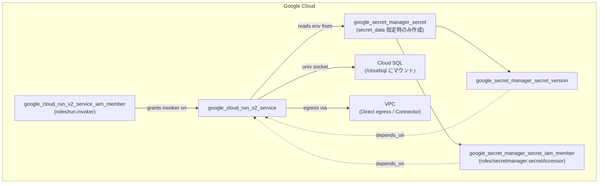

# Cloud Run Service Module

Cloud Run v2 サービスを、Secret Manager 連携・VPC 接続・ヘルスチェック・呼び出し権限まで
含めて 1 つのモジュールコールで構築します。

## なぜこのモジュールを使うのか

Cloud Run にアプリを載せる際、実際に必要になるのはサービス本体だけではありません。

- Secret Manager のシークレット作成とバージョン投入
- サービスアカウントへの `roles/secretmanager.secretAccessor` 付与（**リビジョン作成より前**に
  完了していないと起動に失敗する）
- 公開する場合の `roles/run.invoker` 付与
- Cloud SQL への Unix ソケット接続や Direct VPC egress の設定

これらは別リソースに分かれており、依存順序を間違えると初回 apply が失敗します。

このモジュールは、上記をまとめて扱い、**IAM 付与とシークレットバージョン投入が完了してから
サービスを作成する**依存関係を `depends_on` で明示しています。
また、環境変数を「マップのキー = 環境変数名」で書けるようにし、`dynamic` ブロックを隠蔽します。

## 構成リソース



## 使い方

利用パターンの詳細・プライベートリポジトリの認証・アップグレード手順は
[docs/module_usage.md](../../../docs/module_usage.md) を参照してください。

### パターン A: GitHub 参照

```hcl
module "web" {
  source = "git::https://github.com/kotaitos/terraform-modules.git//modules/google/cloud-run-service?ref=main"

  environment = {
    project_id = "my-project-id"
    region     = "asia-northeast1"
  }

  service = {
    service_name          = "web"
    image                 = "asia-northeast1-docker.pkg.dev/my-project-id/app/web:v1"
    service_account_email = "web-runner@my-project-id.iam.gserviceaccount.com"
    allow_unauthenticated = true
  }
}
```

### パターン B: コピー＆ペースト

`modules/google/cloud-run-service` をディレクトリごと案件リポジトリの `modules/cloud-run-service`
にコピーし、ローカルパスで参照します。変数はパターン A と完全に同じです。

```hcl
module "web" {
  source = "./modules/cloud-run-service"

  environment = {
    project_id = "my-project-id"
    region     = "asia-northeast1"
  }

  service = {
    service_name          = "web"
    image                 = "asia-northeast1-docker.pkg.dev/my-project-id/app/web:v1"
    service_account_email = "web-runner@my-project-id.iam.gserviceaccount.com"
    allow_unauthenticated = true
  }
}
```

### フル構成の例

```hcl
module "web" {
  source = "git::https://github.com/kotaitos/terraform-modules.git//modules/google/cloud-run-service?ref=main"

  environment = {
    project_id = "my-project-id"
    region     = "asia-northeast1"
  }

  service = {
    service_name          = "web"
    image                 = "asia-northeast1-docker.pkg.dev/my-project-id/app/web:v1"
    service_account_email = "web-runner@my-project-id.iam.gserviceaccount.com"

    cpu    = "2000m"
    memory = "1Gi"
    # リクエスト外でも CPU を割り当てたい場合（バックグラウンド処理があるなど）は false
    cpu_idle = true

    min_instances                    = 1
    max_instances                    = 20
    timeout_seconds                  = 60
    max_instance_request_concurrency = 80

    # ロードバランサー経由でのみ受け付ける
    ingress = "INGRESS_TRAFFIC_INTERNAL_LOAD_BALANCER"

    # マップのキーがそのまま環境変数名になる
    env_vars = {
      LOG_LEVEL = { value = "info" }
    }

    secret_env_vars = {
      # 既存のシークレットを参照する（本体は作らず、権限だけ付与）
      DB_PASSWORD = { secret_id = "db-password" }
      # secret_data を渡すとシークレット本体もこのモジュールが作成する
      API_KEY = { secret_id = "web-api-key", secret_data = var.api_key, create_secret = true }
    }

    # コンテナが起動したかを HTTP で確認する
    startup_probe = {
      path                  = "/healthz"
      initial_delay_seconds = 5
      period_seconds        = 3
      failure_threshold     = 10
    }

    # Cloud SQL に Unix ソケット (/cloudsql/...) で接続する
    cloud_sql_instances = ["my-project-id:asia-northeast1:main"]

    # VPC 内のリソースに接続する (Direct VPC egress)
    vpc_access = {
      egress = "PRIVATE_RANGES_ONLY"
      network_interfaces = [{
        network    = "projects/my-project-id/global/networks/main"
        subnetwork = "projects/my-project-id/regions/asia-northeast1/subnetworks/main"
      }]
    }

    # 特定のサービスアカウントにのみ呼び出しを許可する
    invoker_members = [
      "serviceAccount:scheduler@my-project-id.iam.gserviceaccount.com",
    ]

    labels = {
      app = "web"
    }
  }
}
```

## Inputs

| Name | Description | Type | Default | Required |
|------|-------------|------|---------|:--------:|
| environment | 環境設定。 | `object` | n/a | yes |
| service | Cloud Run サービスの設定。 | `object` | n/a | yes |

### `environment`

| Name | Description | Type | Default | Required |
|------|-------------|------|---------|:--------:|
| project_id | デプロイ先の Google Cloud プロジェクト ID。 | `string` | n/a | yes |
| region | サービスを作成するリージョン。 | `string` | n/a | yes |
| project_name | プロジェクト名。このモジュールでは未使用。 | `string` | `null` | no |
| stack_name | スタック名。このモジュールでは未使用。 | `string` | `null` | no |

### `service`

| Name | Description | Type | Default | Required |
|------|-------------|------|---------|:--------:|
| service_name | サービス名。小文字英字始まり、小文字英数字とハイフン、63 文字以内。 | `string` | n/a | yes |
| image | コンテナイメージ。 | `string` | n/a | yes |
| service_account_email | リビジョンの実行に使うサービスアカウント。 | `string` | n/a | yes |
| description | サービスの説明。 | `string` | `null` | no |
| labels | サービスに付けるラベル。 | `map(string)` | `{}` | no |
| annotations | サービスに付けるアノテーション。 | `map(string)` | `{}` | no |
| cpu | CPU 上限 (例: `"1000m"`, `"2"`)。 | `string` | `"1000m"` | no |
| memory | メモリ上限 (例: `"512Mi"`, `"1Gi"`)。 | `string` | `"512Mi"` | no |
| startup_cpu_boost | 起動時に CPU を追加割り当てするか。 | `bool` | `true` | no |
| cpu_idle | `true` はリクエスト処理中のみ CPU を割り当てる。常時 CPU が必要な場合は `false`。 | `bool` | `true` | no |
| container_ports | 公開するコンテナポート。Cloud Run v2 は 1 つまで。 | `list(number)` | `[8080]` | no |
| use_http2 | `true` の場合、コンテナが HTTP/2 (h2c) を直接受ける。gRPC で使う。 | `bool` | `false` | no |
| env_vars | 平文の環境変数。マップのキーが環境変数名になる。環境変数名は英字かアンダースコア始まり、英数字とアンダースコアのみ（ハイフン不可）。`env_vars` と `secret_env_vars` を通して一意であること。 | `map(object)` | `{}` | no |
| secret_env_vars | Secret Manager 由来の環境変数。マップのキーが環境変数名になる。環境変数名は英字かアンダースコア始まり、英数字とアンダースコアのみ（ハイフン不可）。`env_vars` と `secret_env_vars` を通して一意であること。 | `map(object)` | `{}` | no |
| timeout_seconds | リクエストのタイムアウト秒数 (1〜3600)。 | `number` | `300` | no |
| max_instance_request_concurrency | 1 インスタンスが同時に処理するリクエスト数。 | `number` | `80` | no |
| min_instances | 最小インスタンス数。 | `number` | `0` | no |
| max_instances | 最大インスタンス数。 | `number` | `100` | no |
| session_affinity | セッションアフィニティを有効にするか。 | `bool` | `false` | no |
| ingress | `INGRESS_TRAFFIC_ALL` / `INGRESS_TRAFFIC_INTERNAL_ONLY` / `INGRESS_TRAFFIC_INTERNAL_LOAD_BALANCER`。 | `string` | `"INGRESS_TRAFFIC_ALL"` | no |
| allow_unauthenticated | `true` の場合 `allUsers` に `roles/run.invoker` を付与し、認証なしで公開する。 | `bool` | `false` | no |
| invoker_members | `roles/run.invoker` を付与するメンバー。 | `list(string)` | `[]` | no |
| custom_audiences | ID トークン検証で許可するカスタムオーディエンス。 | `list(string)` | `null` | no |
| vpc_access | VPC 接続設定。 | `object` | `null` | no |
| cloud_sql_instances | `/cloudsql` にマウントする Cloud SQL のインスタンス接続名。 | `list(string)` | `[]` | no |
| execution_environment | `EXECUTION_ENVIRONMENT_GEN1` または `EXECUTION_ENVIRONMENT_GEN2`。 | `string` | `null` | no |
| encryption_key | CMEK で暗号化する場合の Cloud KMS 鍵。 | `string` | `null` | no |
| deletion_protection | `true` の場合、Terraform からのサービス削除をブロックする。 | `bool` | `true` | no |
| startup_probe | 起動時のヘルスチェック設定。 | `object` | `null` | no |
| liveness_probe | 稼働中のヘルスチェック設定。 | `object` | `null` | no |

### `service.env_vars[*]`

| Name | Description | Type | Default | Required |
|------|-------------|------|---------|:--------:|
| name | 環境変数名。省略時はマップのキーが使われる。 | `string` | `null` | no |
| value | 環境変数の値。 | `string` | n/a | yes |

### `service.secret_env_vars[*]`

| Name | Description | Type | Default | Required |
|------|-------------|------|---------|:--------:|
| name | 環境変数名。省略時はマップのキーが使われる。 | `string` | `null` | no |
| secret_id | Secret Manager のシークレット ID。英大小文字・数字・`-`・`_` のみ、255 文字以内。 | `string` | n/a | yes |
| version | 参照するバージョン。 | `string` | `"latest"` | no |
| secret_data | 指定するとシークレット本体とバージョンもこのモジュールが作成する。 | `string` | `null` | no |
| create_secret | シークレットを作成するかを明示指定する。省略時は `secret_data` の有無で判定。 | `bool` | `null` | no |

### `service.vpc_access`

Serverless VPC Access コネクタ（`connector`）と Direct VPC egress（`network_interfaces`）は
併用できません。どちらか一方を指定してください。

| Name | Description | Type | Default | Required |
|------|-------------|------|---------|:--------:|
| connector | Serverless VPC Access コネクタ。 | `string` | `null` | no |
| egress | `ALL_TRAFFIC` または `PRIVATE_RANGES_ONLY`。 | `string` | `null` | no |
| network_interfaces | Direct VPC egress の設定。 | `list(object)` | `[]` | no |

### `service.vpc_access.network_interfaces[*]`

Direct VPC egress の設定です。`network` と `subnetwork` は、プロジェクトを含む完全な形式
（`projects/<project>/global/networks/<name>`）でも、同一プロジェクト内なら名前だけでも指定できます。

| Name | Description | Type | Default | Required |
|------|-------------|------|---------|:--------:|
| network | 接続する VPC ネットワーク。 | `string` | `null` | no |
| subnetwork | 接続するサブネットワーク。 | `string` | `null` | no |
| tags | 適用するネットワークタグ。 | `list(string)` | `null` | no |

### `service.startup_probe` / `service.liveness_probe`

`path` を指定すると HTTP GET、省略すると TCP ソケットでの死活監視になります。

| Name | Description | Type | Default | Required |
|------|-------------|------|---------|:--------:|
| path | HTTP GET のパス。 | `string` | `null` | no |
| port | 監視先ポート。省略時は `container_ports` の値。 | `number` | `null` | no |
| initial_delay_seconds | 初回チェックまでの待ち時間。 | `number` | `null` | no |
| timeout_seconds | 1 回のチェックのタイムアウト。 | `number` | `null` | no |
| period_seconds | チェック間隔。 | `number` | `null` | no |
| failure_threshold | 失敗と判断するまでの連続失敗回数。 | `number` | `null` | no |

## Outputs

| Name | Description |
|------|-------------|
| service | 作成された Cloud Run サービスのリソース全体。 |
| service_url | Cloud Run が払い出したサービスの URL。 |
| service_name | Cloud Run サービスの名前。 |
| service_id | Cloud Run サービスの Terraform リソース ID。 |
| service_location | Cloud Run サービスを作成したリージョン。 |
| latest_ready_revision | トラフィックを受け付けている最新リビジョンの名前。 |
| managed_secret_ids | このモジュールが作成したシークレットの ID（環境変数キー => `secret_id`）。 |
| is_public | `allUsers` に `roles/run.invoker` が付与されているか。 |

## Requirements

| Name | Version |
|------|---------|
| terraform | >= 1.10 |
| google | >= 6.0.0, < 8.0.0 |

## Notes

- **トラフィックは常に最新リビジョンへ 100% 割り当てられます。**
  カナリアリリースなどのトラフィック分割が必要な場合は、このモジュールをそのまま使えません。
- `secret_env_vars` の `secret_data` は **plan 時に値が確定している必要があります**。
  他リソースの出力（apply 時に決まる値）を渡す場合は、`create_secret = true` を明示してください。
  そうしないと「for_each の値が確定できない」というエラーになります。
- `deletion_protection` の既定値は `true` です。`terraform destroy` でサービスを消す場合は、
  先に `deletion_protection = false` で apply してください。
- `lifecycle.ignore_changes` で `client` / `client_version` / コンテナ名を無視しています。
  `gcloud run deploy` や Console から手動デプロイしても、Terraform が差分として検出しません。
  逆に、**手動デプロイしたイメージは次の apply で `image` の値に戻されます。**
- ラベルは `labels` をサービスと、このモジュールが作成するシークレットの両方に付与します
  （シークレットには追加で `service = <service_name>` が付きます）。
