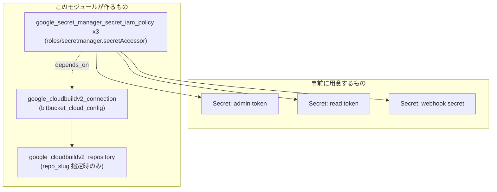

# Cloud Build Bitbucket Connection Module

Cloud Build から Bitbucket Cloud のリポジトリを利用するための接続 (Cloud Build v2 Connection) を
構築します。接続に必要な Secret Manager のアクセス権付与までを含みます。

## なぜこのモジュールを使うのか

Cloud Build の Bitbucket 連携は、接続リソースを作る前に **Cloud Build サービスエージェント
(`service-<project_number>@gcp-sa-cloudbuild.iam.gserviceaccount.com`) が 3 つのシークレット
（管理トークン・読み取りトークン・Webhook シークレット）を読める状態**になっていないと失敗します。
サービスエージェントのアドレスはプロジェクト番号から組み立てる必要があり、シークレットは
`projects/<project_number>/secrets/<id>/versions/<version>` という完全修飾名で指定します。

このモジュールは、

- プロジェクト番号（省略時は API から解決）からサービスエージェントとシークレット完全修飾名を組み立てる
- 3 つのシークレットへ `roles/secretmanager.secretAccessor` を付与し、その完了を待って接続を作る
- `repo_slug` を渡せば、Cloud Build トリガーから参照できるリポジトリリソースも併せて作る

ことで、この順序依存を利用者が意識しなくて済むようにしています。

## 構成リソース



## 事前準備

Bitbucket 側でトークンを発行し、Secret Manager にシークレットとして登録しておく必要があります。
**シークレット本体はこのモジュールでは作成しません。**

| シークレット | 内容 |
| :--- | :--- |
| `admin_token_secret` | Bitbucket の App password（リポジトリ管理権限あり）。Webhook の作成に使われる。 |
| `read_token_secret` | Bitbucket の App password（リポジトリ読み取り権限）。ソースの取得に使われる。 |
| `webhook_secret` | 任意のランダム文字列。Webhook の署名検証に使われる。 |

```bash
printf '%s' "$BITBUCKET_ADMIN_TOKEN" | gcloud secrets create bitbucket-admin-token --data-file=- --project my-project-id
printf '%s' "$BITBUCKET_READ_TOKEN"  | gcloud secrets create bitbucket-read-token  --data-file=- --project my-project-id
openssl rand -base64 32 | tr -d '\n' | gcloud secrets create bitbucket-webhook-secret --data-file=- --project my-project-id
```

## 使い方

利用パターンの詳細・プライベートリポジトリの認証・アップグレード手順は
[docs/module_usage.md](../../../docs/module_usage.md) を参照してください。

### パターン A: GitHub 参照

```hcl
module "bitbucket_connection" {
  source = "git::https://github.com/kotaitos/terraform-modules.git//modules/google/cloudbuild-bitbucket-connection?ref=main"

  environment = {
    project_id = "my-project-id"
    region     = "asia-northeast1"
  }

  bitbucket_config = {
    workspace          = "my-workspace"
    connection_name    = "bitbucket-connection"
    admin_token_secret = "bitbucket-admin-token"
    read_token_secret  = "bitbucket-read-token"
    webhook_secret     = "bitbucket-webhook-secret"
  }
}
```

### パターン B: コピー＆ペースト

`modules/google/cloudbuild-bitbucket-connection` をディレクトリごと案件リポジトリの
`modules/cloudbuild-bitbucket-connection` にコピーし、ローカルパスで参照します。
変数はパターン A と完全に同じです。

```hcl
module "bitbucket_connection" {
  source = "./modules/cloudbuild-bitbucket-connection"

  environment = {
    project_id = "my-project-id"
    region     = "asia-northeast1"
  }

  bitbucket_config = {
    workspace          = "my-workspace"
    connection_name    = "bitbucket-connection"
    admin_token_secret = "bitbucket-admin-token"
    read_token_secret  = "bitbucket-read-token"
    webhook_secret     = "bitbucket-webhook-secret"
  }
}
```

### リポジトリの紐付けとトリガーの作成

`repo_slug` を指定するとリポジトリリソースも作成され、その ID を Cloud Build トリガーに渡せます。

```hcl
module "bitbucket_connection" {
  source = "git::https://github.com/kotaitos/terraform-modules.git//modules/google/cloudbuild-bitbucket-connection?ref=main"

  environment = {
    project_id = "my-project-id"
    region     = "asia-northeast1"
  }

  project_number = "123456789012" # 省略すると API から解決する

  bitbucket_config = {
    workspace          = "my-workspace"
    connection_name    = "bitbucket-connection"
    admin_token_secret = "bitbucket-admin-token"
    read_token_secret  = "bitbucket-read-token"
    webhook_secret     = "bitbucket-webhook-secret"
    repo_slug          = "my-repo"
  }

  # Cloud Build サービスエージェント以外にシークレットの読み取りを許可する
  additional_secret_accessors = [
    "serviceAccount:platform-admin@my-project-id.iam.gserviceaccount.com",
  ]
}

resource "google_cloudbuild_trigger" "main" {
  project  = "my-project-id"
  location = "asia-northeast1"
  name     = "my-repo-main"

  repository_event_config {
    repository = module.bitbucket_connection.repository_id
    push {
      branch = "^main$"
    }
  }

  filename = "cloudbuild.yaml"
}
```

## Inputs

| Name | Description | Type | Default | Required |
|------|-------------|------|---------|:--------:|
| environment | 環境設定。接続は `environment.region` に作成されます。 | `object` | `null` | no* |
| project_id | **非推奨**: `environment.project_id` を使用。デプロイ先の Google Cloud プロジェクト ID。 | `string` | `null` | no* |
| region | **非推奨**: `environment.region` を使用。Cloud Build 接続を作成するリージョン。 | `string` | `null` | no* |
| bitbucket_config | Bitbucket Cloud 接続の設定。 | `object` | n/a | yes |
| project_number | プロジェクト番号。省略時は `google_project` データソースから取得する。 | `string` | `null` | no |
| additional_secret_accessors | シークレットに `roles/secretmanager.secretAccessor` を追加で付与するメンバー。 | `list(string)` | `[]` | no |

\* `environment`、または非推奨の `project_id` と `region` の**両方**が必須です
（`environment` とフラット変数の同時指定は plan でエラーになります）。
新しく書くコードでは `environment` を使ってください。
`project_number` は `environment` の形に無い値なので、これまでどおりトップレベルで指定します。

### `environment`

| Name | Description | Type | Default | Required |
|------|-------------|------|---------|:--------:|
| project_id | デプロイ先の Google Cloud プロジェクト ID。 | `string` | n/a | yes |
| region | Cloud Build 接続を作成するリージョン (例: `asia-northeast1`)。 | `string` | n/a | yes |
| project_name | プロジェクト名。このモジュールでは未使用。 | `string` | `null` | no |
| stack_name | スタック名。このモジュールでは未使用。 | `string` | `null` | no |

### `bitbucket_config`

| Name | Description | Type | Default | Required |
|------|-------------|------|---------|:--------:|
| workspace | Bitbucket のワークスペース ID。 | `string` | n/a | yes |
| connection_name | Cloud Build 接続の名前。 | `string` | n/a | yes |
| admin_token_secret | 管理トークンを格納した Secret Manager のシークレット **ID**（完全修飾名ではない）。 | `string` | n/a | yes |
| read_token_secret | 読み取りトークンを格納したシークレット ID。 | `string` | n/a | yes |
| webhook_secret | Webhook シークレットを格納したシークレット ID。 | `string` | n/a | yes |
| repo_slug | 指定するとその Bitbucket リポジトリを接続に紐付けるリソースも作成する。 | `string` | `null` | no |
| secret_version | 参照するシークレットのバージョン。 | `string` | `"latest"` | no |

## Outputs

| Name | Description |
|------|-------------|
| connection | 作成された Cloud Build 接続のリソース全体。 |
| connection_id | Cloud Build 接続の Terraform リソース ID。 |
| connection_name | Cloud Build 接続の名前。 |
| installation_state | 接続のインストール状態。Bitbucket 側で追加操作が必要な場合はここに指示が入る。 |
| repository | 作成された Cloud Build リポジトリ。`repo_slug` 未指定時は `null`。 |
| repository_id | Cloud Build リポジトリの Terraform リソース ID（トリガーの `repository` に指定する）。 |
| cloudbuild_service_agent | シークレットへのアクセスを許可した Cloud Build サービスエージェント。 |
| project_number | 解決されたプロジェクト番号。 |

## Requirements

| Name | Version |
|------|---------|
| terraform | >= 1.10 |
| google | >= 6.0.0, < 8.0.0 |

## Notes

> [!WARNING]
> このモジュールは **authoritative** な `google_secret_manager_secret_iam_policy` を使用します。
> 対象の 3 つのシークレットに対して、モジュール外で付与された IAM バインディング
> （手動付与・他の Terraform コード・他モジュールによるもの）は **apply 時に削除されます**。
> Cloud Build サービスエージェント以外にアクセスを許可したいメンバーは、必ず
> `additional_secret_accessors` に列挙してください。

- `project_number` を省略すると `google_project` データソースを参照します。plan 時に
  `resourcemanager.projects.get` 権限が必要になるため、権限を絞った CI では明示指定を推奨します。
- 接続の作成後、Bitbucket 側で連携の承認が必要な場合があります。`installation_state` 出力に
  次に行うべき操作が入るので確認してください。
- `secret_version` を `"latest"` 以外に固定した場合、トークンをローテーションしても
  接続は古いバージョンを参照し続けます。ローテーション運用をするなら `"latest"` のままにしてください。
- v1.0.0 以前は `bitbucket_config` 全体が `sensitive = true` でしたが、
  格納しているのはシークレットの**名前**であり値ではないため解除しました。これにより、
  `connection` 出力が「sensitive な値を参照している」という plan エラーを起こさなくなりました。
- リソースアドレスを整理したため、`moved.tf` で state を自動移行します。
  利用者側で `terraform state mv` を実行する必要はありません。

## 既存構成からのアップグレード

| 変更 | plan に現れる内容 | 対応 |
| :--- | :--- | :--- |
| プロジェクト ID とリージョンを `environment` でも渡せるようになった | なし | 不要。`project_id` / `region` のままでも動きます。書き換えるなら `environment = { project_id = "...", region = "..." }` にしてください（`environment` とフラット変数の同時指定は plan でエラーになります） |
