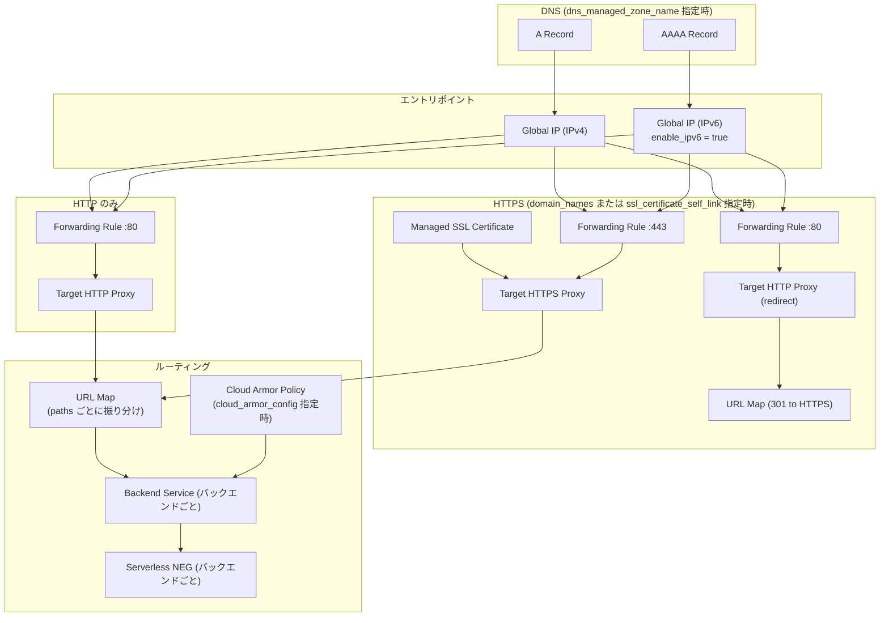

# External Load Balancer Module

サーバーレスバックエンド（Cloud Run / Cloud Functions / App Engine）向けの外部アプリケーション
ロードバランサーを、SSL 証明書・DNS レコード・HTTP→HTTPS リダイレクト・Cloud Armor まで含めて
1 つのモジュールコールで構築します。

## なぜこのモジュールを使うのか

Cloud Run を独自ドメインで公開するだけでも、Google Cloud では 8 種類以上のリソースを
正しい順序で組み合わせる必要があります（グローバル IP、マネージド証明書、DNS レコード、
サーバーレス NEG、バックエンドサービス、URL マップ、ターゲットプロキシ、転送ルール）。
HTTPS にする場合は HTTP からのリダイレクト用に URL マップとプロキシと転送ルールがもう 1 セット、
IPv6 に対応するなら転送ルールがさらに倍になります。

このモジュールは、`domain_names` を渡すかどうかだけで HTTP 構成と HTTPS + リダイレクト構成を
切り替え、バックエンドを `neg_backends` のマップで宣言するだけでパスベースのルーティングまで
組み立てます。Cloud Armor もバックエンド単位で付けられます。

## 構成リソース



## 使い方

利用パターンの詳細・プライベートリポジトリの認証・アップグレード手順は
[docs/module_usage.md](../../../docs/module_usage.md) を参照してください。

### パターン A: GitHub 参照

```hcl
module "external_lb" {
  source = "git::https://github.com/brainpad-whiterabbit/terraform-modules.git//modules/google/external-lb?ref=v1.0.0"

  environment = {
    project_id = "my-project-id"
  }

  lb_name             = "my-lb"
  default_backend_key = "main"

  neg_backends = {
    main = {
      type         = "cloud-run"
      service_name = "web"
      region       = "asia-northeast1"
      paths        = ["/*"]
    }
  }
}
```

### パターン B: コピー＆ペースト

`modules/google/external-lb` をディレクトリごと案件リポジトリの `modules/external-lb` に
コピーし、ローカルパスで参照します。変数はパターン A と完全に同じです。

```hcl
module "external_lb" {
  source = "./modules/external-lb"

  environment = {
    project_id = "my-project-id"
  }

  lb_name             = "my-lb"
  default_backend_key = "main"

  neg_backends = {
    main = {
      type         = "cloud-run"
      service_name = "web"
      region       = "asia-northeast1"
      paths        = ["/*"]
    }
  }
}
```

### 独自ドメインで HTTPS 公開 + パスベースルーティング

```hcl
module "external_lb" {
  source = "git::https://github.com/brainpad-whiterabbit/terraform-modules.git//modules/google/external-lb?ref=v1.0.0"

  environment = {
    project_id = "my-project-id"
  }

  lb_name             = "my-lb"
  default_backend_key = "main"

  # Google 管理証明書と DNS レコードを自動作成し、HTTP は HTTPS へリダイレクトする
  domain_names          = ["app.example.com", "www.example.com"]
  dns_managed_zone_name = "example-zone"
  enable_ipv6           = true

  neg_backends = {
    # / 配下すべて → web サービス
    main = {
      type         = "cloud-run"
      service_name = "web"
      region       = "asia-northeast1"
      paths        = ["/*"]
      log_config   = { enable = true, sample_rate = 1.0 }
    }

    # /api 配下 → api サービス。オフィス IP のみ許可する
    api = {
      type         = "cloud-run"
      service_name = "api"
      region       = "asia-northeast1"
      paths        = ["/api/*"]
      timeout_sec  = 60

      cloud_armor_config = {
        enabled             = true
        default_rule_action = "deny(403)"
        rules = {
          allow_office = {
            action        = "allow"
            priority      = 1000
            src_ip_ranges = ["203.0.113.0/24"]
            description   = "Allow office IP"
          }
          block_bad_bot = {
            action      = "deny(403)"
            priority    = 2000
            expression  = "request.headers['user-agent'].contains('BadBot')"
            description = "Block a known bad bot"
          }
        }
      }
    }
  }
}
```

## Inputs

| Name | Description | Type | Default | Required |
|------|-------------|------|---------|:--------:|
| environment | 環境設定。 | `object` | `null` | no* |
| project_id | **非推奨**: `environment.project_id` を使用。デプロイ先の Google Cloud プロジェクト ID。 | `string` | `null` | no* |
| lb_name | ロードバランサーと関連リソース名の接頭辞。28 文字以内。 | `string` | n/a | yes |
| neg_backends | サーバーレス NEG バックエンドのマップ。キーがリソース名の一部になる。 | `map(object)` | n/a | yes |
| default_backend_key | どのパスにもマッチしなかったリクエストを処理する `neg_backends` のキー。 | `string` | n/a | yes |
| domain_names | Google 管理 SSL 証明書と DNS レコードの対象ドメイン。1 つ以上指定すると HTTPS になる。 | `list(string)` | `[]` | no |
| domain_name | **非推奨**: `domain_names` を使用。単一ドメイン指定の旧インターフェース。 | `string` | `null` | no |
| dns_managed_zone_name | DNS レコードを作成する Cloud DNS マネージドゾーン名。省略時は DNS レコードを作らない。 | `string` | `null` | no |
| ssl_certificate_self_link | 既存 SSL 証明書の self_link。`domain_names` 指定時は無視される。 | `string` | `null` | no |
| ssl_policy | HTTPS プロキシに適用する SSL ポリシーの self_link。 | `string` | `null` | no |
| enable_ipv6 | IPv6 のグローバル IP と転送ルールも作成する。 | `bool` | `false` | no |
| load_balancing_scheme | `EXTERNAL_MANAGED`（推奨）または `EXTERNAL`（クラシック）。 | `string` | `"EXTERNAL_MANAGED"` | no |

\* `environment` と `project_id` は**どちらか一方が必須**です（両方の同時指定は plan でエラーになります）。
新しく書くコードでは `environment` を使ってください。

### `environment`

このモジュールは `project_id` のみを使用しますが、他モジュールとインターフェースを揃えるため
同じ形を受け取ります。バックエンドのリージョンは `neg_backends[*].region` で指定します。

| Name | Description | Type | Default | Required |
|------|-------------|------|---------|:--------:|
| project_id | デプロイ先の Google Cloud プロジェクト ID。 | `string` | n/a | yes |
| project_name | プロジェクト名。このモジュールでは未使用。 | `string` | `null` | no |
| region | リージョン。このモジュールでは未使用（外部 ALB は global）。 | `string` | `null` | no |
| stack_name | スタック名。このモジュールでは未使用。 | `string` | `null` | no |

### `neg_backends[*]`

| Name | Description | Type | Default | Required |
|------|-------------|------|---------|:--------:|
| type | `cloud-run` / `cloud-function` / `app-engine`。 | `string` | n/a | yes |
| service_name | Cloud Run サービス名 / Cloud Functions 関数名 / App Engine サービス名。 | `string` | n/a | yes |
| region | バックエンドのリージョン。 | `string` | n/a | yes |
| paths | このバックエンドにルーティングする URL パス (例: `["/api/*"]`)。 | `list(string)` | n/a | yes |
| app_engine_version | `app-engine` のみ: 対象バージョン。省略時は default バージョン。 | `string` | `null` | no |
| timeout_sec | バックエンドのタイムアウト秒数。 | `number` | `30` | no |
| port_name | バックエンドのポート名。 | `string` | `"http"` | no |
| protocol | バックエンドのプロトコル。 | `string` | `"HTTP"` | no |
| description | バックエンドサービスの説明。 | `string` | `null` | no |
| enable_cdn | Cloud CDN を有効にする。 | `bool` | `false` | no |
| log_config | アクセスログの設定。 | `object` | `null` | no |
| cloud_armor_config | Cloud Armor セキュリティポリシーの設定。 | `object` | `null` | no |

### `neg_backends[*].log_config`

省略した場合はバックエンドサービスの既定（アクセスログ無効）になります。

| Name | Description | Type | Default | Required |
|------|-------------|------|---------|:--------:|
| enable | アクセスログを有効にする。 | `bool` | `true` | no |
| sample_rate | サンプリング率 (`0.0`〜`1.0`)。 | `number` | `1.0` | no |

### `neg_backends[*].cloud_armor_config`

| Name | Description | Type | Default | Required |
|------|-------------|------|---------|:--------:|
| enabled | `true` の場合のみポリシーを作成し、バックエンドに紐付ける。 | `bool` | n/a | yes |
| default_rule_action | どのルールにもマッチしなかった場合のアクション。 | `string` | `"deny(403)"` | no |
| description | ポリシーの説明。 | `string` | `null` | no |
| rules | ルールのマップ。 | `map(object)` | n/a | yes |

### `neg_backends[*].cloud_armor_config.rules[*]`

`src_ip_ranges` と `expression` は**どちらか一方のみ**を指定します。

| Name | Description | Type | Default | Required |
|------|-------------|------|---------|:--------:|
| action | `allow` / `deny(403)` など。 | `string` | n/a | yes |
| priority | 評価順（小さいほど優先）。同一バックエンド内で一意、`2147483647` 未満。 | `number` | n/a | yes |
| description | ルールの説明。 | `string` | `null` | no |
| src_ip_ranges | マッチさせる送信元 IP レンジ。 | `list(string)` | `null` | no |
| expression | マッチさせる CEL 式。 | `string` | `null` | no |
| preview | プレビューモード（ブロックせずログのみ）。 | `bool` | `false` | no |

## Outputs

| Name | Description |
|------|-------------|
| load_balancer_ip | ロードバランサーの IPv4 アドレス。 |
| load_balancer_ipv6_address | ロードバランサーの IPv6 アドレス。`enable_ipv6 = false` の場合は `null`。 |
| is_https_enabled | HTTPS が有効か。 |
| domains | SSL 証明書と DNS レコードの対象ドメイン。 |
| ssl_certificate_self_link | HTTPS プロキシに設定した SSL 証明書の self_link。 |
| managed_ssl_certificate | このモジュールが作成した Google 管理 SSL 証明書。外部証明書利用時は `null`。 |
| url_map_id | URL マップの ID。 |
| backend_service_ids | バックエンドサービスの ID（キー => ID）。 |
| backend_service_names | バックエンドサービスの名前（キー => 名前）。 |
| network_endpoint_group_ids | サーバーレス NEG の ID（キー => ID）。 |
| security_policy_ids | Cloud Armor ポリシーの ID（キー => ID）。有効にしたバックエンドのみ。 |
| forwarding_rule_names | 作成された転送ルールの名前一覧。 |

## Requirements

| Name | Version |
|------|---------|
| terraform | >= 1.10 |
| google | >= 6.0.0, < 8.0.0 |

## Notes

- **Google 管理証明書の発行には DNS の伝播が必要です。** `domain_names` を指定して apply した直後は
  証明書が `PROVISIONING` 状態で、HTTPS は数分〜数十分つながりません。
  `dns_managed_zone_name` を指定してこのモジュールに A レコードを作らせるか、
  外部 DNS を使う場合は `load_balancer_ip` を手動で登録してください。
- 証明書名にはドメインのハッシュが含まれ、`create_before_destroy = true` が付いています。
  `domain_names` を変更すると、新しい証明書を作ってからプロキシを差し替え、古い証明書を削除します。
- `neg_backends` の `paths` は全バックエンドを通して重複できません（URL マップの制約）。
  デフォルトバックエンドにも `paths` の指定が必要です（`["/*"]` を推奨）。
- `load_balancing_scheme` の既定値は `EXTERNAL_MANAGED`（グローバル外部アプリケーション
  ロードバランサー）です。稼働中の環境でこの値を変更すると、バックエンドサービスと転送ルールが
  **再作成**され、切り替え中は接続が失敗します。
- サーバーレス NEG は Cloud Run / Cloud Functions / App Engine 側のサービスを**参照するだけ**です。
  サービス自体はこのモジュールでは作成しません
  （[cloud-run-service](../cloud-run-service) モジュールなどを併用してください）。
- Cloud Run 側の `ingress` を `INGRESS_TRAFFIC_INTERNAL_LOAD_BALANCER` にすると、
  ロードバランサー経由のアクセスのみに制限できます。

## 既存構成からのアップグレード

このモジュールの初版から更新する場合、以下は `terraform plan` に差分として現れます。
いずれもロードバランサーの再構成を伴うため、**メンテナンスウィンドウを取ってから apply してください。**

| 変更 | plan に現れる内容 | 理由 |
| :--- | :--- | :--- |
| `load_balancing_scheme` の既定値が `EXTERNAL_MANAGED` になった | バックエンドサービスと転送ルールの**再作成** | クラシック ALB からグローバル外部 ALB への移行。従来どおりにするなら `load_balancing_scheme = "EXTERNAL"` を明示する |
| バックエンドサービス / Cloud Armor ポリシー名でキーを切り詰めなくなった | 該当リソースの**再作成** | `substr(key, 0, 15)` によるキーの衝突を避けるため |
| SSL 証明書名にドメインのハッシュが付いた | 証明書の入れ替え（`create_before_destroy` のため無停止） | ドメイン変更時に名前衝突なく差し替えられるようにするため |
| プロジェクト ID を `environment` でも渡せるようになった | なし | 不要。`project_id = "..."` のままでも動きます。書き換えるなら `environment = { project_id = "..." }` にしてください（同時指定は plan でエラーになります） |
| DNS レコードが `count` から `for_each` になった | `google_dns_record_set.a[0]` の削除と `...a["<domain>"]` の作成 | 複数ドメインに対応するため。キーが動的なため `moved` ブロックでは表現できない |

DNS レコードの再作成を避けたい場合は、apply の前に手動で state を移してください。

```bash
terraform state mv 'module.external_lb.google_dns_record_set.a[0]' \
  'module.external_lb.google_dns_record_set.a["app.example.com"]'
```

### 主な機能追加

- `domain_names` による複数ドメイン対応（`domain_name` は非推奨だが引き続き利用可能）
- `enable_ipv6` が HTTP のみの構成でも IPv6 転送ルールを作成するようになった（以前は
  IPv6 アドレスが作られるだけで到達できなかった）
- `cloud-function` / `app-engine` バックエンドのサポート
- `enable_cdn`、`log_config`、`ssl_policy` の追加
- `validation` による事前チェック（`default_backend_key` の存在確認、`paths` の重複、
  Cloud Armor ルールの排他条件など）
