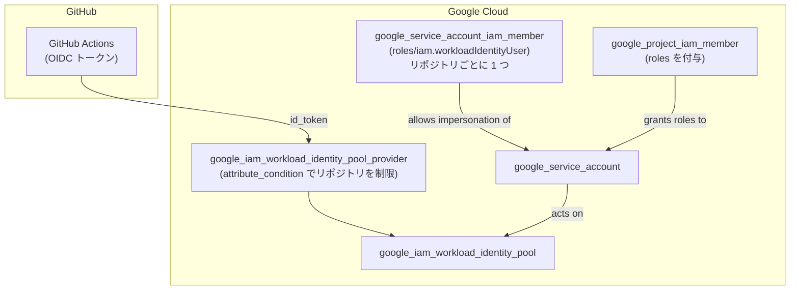

# GitHub OIDC Module

GitHub Actions から Google Cloud へ、**サービスアカウントキーを配布せずに**認証するための
Workload Identity 連携（Workload Identity Pool / Provider / サービスアカウント / IAM）を構築します。

## なぜこのモジュールを使うのか

GitHub Actions の OIDC 連携は、リソースを個別に作るだけでは安全になりません。

- `attribute_condition` を設定し忘れると、**任意の GitHub リポジトリ**から
  そのサービスアカウントになりすませてしまいます。
- サービスアカウント側に `roles/iam.workloadIdentityUser` を
  `principalSet://.../attribute.repository/<owner>/<repo>` で付与する必要があります。
- GitHub Actions 側に渡す `workload_identity_provider` の値は Terraform のリソース ID ではなく
  `projects/<プロジェクト番号>/locations/global/workloadIdentityPools/<pool>/providers/<provider>`
  という完全修飾名です。

このモジュールは、許可するリポジトリを渡すだけでこれらを正しく組み立て、
GitHub Actions のワークフローにそのまま貼れる認証ステップまで出力します。

## 構成リソース



## 使い方

利用パターンの詳細・プライベートリポジトリの認証・アップグレード手順は
[docs/module_usage.md](../../../docs/module_usage.md) を参照してください。

### パターン A: GitHub 参照

```hcl
module "github_oidc" {
  source = "git::https://github.com/brainpad-whiterabbit/terraform-modules.git//modules/google/github-oidc?ref=v1.0.0"

  environment = {
    project_id = "my-project-id"
  }

  github_oidc_config = {
    repository = "my-org/my-repo"
  }

  service_account_config = {
    account_id   = "github-actions-sa"
    display_name = "GitHub Actions Service Account"
    roles = [
      "roles/run.admin",
      "roles/iam.serviceAccountUser",
    ]
  }
}
```

### パターン B: コピー＆ペースト

`modules/google/github-oidc` をディレクトリごと案件リポジトリの `modules/github-oidc` に
コピーし、ローカルパスで参照します。変数はパターン A と完全に同じです。

```hcl
module "github_oidc" {
  source = "./modules/github-oidc"

  environment = {
    project_id = "my-project-id"
  }

  github_oidc_config = {
    repository = "my-org/my-repo"
  }

  service_account_config = {
    account_id   = "github-actions-sa"
    display_name = "GitHub Actions Service Account"
    roles        = ["roles/run.admin"]
  }
}
```

### 複数リポジトリ / ブランチ制限

```hcl
module "github_oidc" {
  source = "git::https://github.com/brainpad-whiterabbit/terraform-modules.git//modules/google/github-oidc?ref=v1.0.0"

  environment = {
    project_id = "my-project-id"
  }

  github_oidc_config = {
    repositories = ["my-org/app", "my-org/infra"]

    # main ブランチからの実行のみ許可する
    extra_attribute_condition = "assertion.ref == 'refs/heads/main'"

    # 条件で使う属性は attribute_mapping にも追加しておくと、
    # Cloud Logging から誰が使ったか追跡しやすくなる
    extra_attribute_mapping = {
      "attribute.ref" = "assertion.ref"
    }
  }

  service_account_config = {
    account_id   = "github-actions-deployer"
    display_name = "GitHub Actions Deployer"
    roles        = ["roles/run.admin", "roles/artifactregistry.writer"]
  }
}
```

### GitHub Actions 側の設定

`github_actions_auth_step` 出力をそのままワークフローに貼り付けられます。

```hcl
output "github_actions_auth_step" {
  value = module.github_oidc.github_actions_auth_step
}
```

```yaml
jobs:
  deploy:
    permissions:
      contents: read
      id-token: write # OIDC トークンの発行に必須
    runs-on: ubuntu-latest
    steps:
      - uses: actions/checkout@v4
      - uses: google-github-actions/auth@v2
        with:
          project_id: my-project-id
          workload_identity_provider: projects/123456789012/locations/global/workloadIdentityPools/github-actions/providers/github-actions-provider
          service_account: github-actions-sa@my-project-id.iam.gserviceaccount.com
```

## Inputs

| Name | Description | Type | Default | Required |
|------|-------------|------|---------|:--------:|
| environment | 環境設定。 | `object` | `null` | no* |
| project_id | **非推奨**: `environment.project_id` を使用。デプロイ先の Google Cloud プロジェクト ID。 | `string` | `null` | no* |
| github_oidc_config | GitHub OIDC プロバイダーの設定。 | `object` | n/a | yes |
| service_account_config | 作成してGitHub Actions に関連付けるサービスアカウントの設定。 | `object` | n/a | yes |

\* `environment` と `project_id` は**どちらか一方が必須**です（両方の同時指定は plan でエラーになります）。
新しく書くコードでは `environment` を使ってください。

### `environment`

このモジュールは `project_id` のみを使用しますが、他モジュールとインターフェースを揃えるため
同じ形を受け取ります。

| Name | Description | Type | Default | Required |
|------|-------------|------|---------|:--------:|
| project_id | デプロイ先の Google Cloud プロジェクト ID。 | `string` | n/a | yes |
| project_name | プロジェクト名。このモジュールでは未使用。 | `string` | `null` | no |
| region | リージョン。このモジュールでは未使用（Workload Identity Pool は global）。 | `string` | `null` | no |
| stack_name | スタック名。このモジュールでは未使用。 | `string` | `null` | no |

### `github_oidc_config`

`repository` と `repositories` のどちらか（または両方）で、許可するリポジトリを指定します。

| Name | Description | Type | Default | Required |
|------|-------------|------|---------|:--------:|
| repository | `owner/repo` 形式の GitHub リポジトリ（単一）。 | `string` | `null` | no |
| repositories | `owner/repo` 形式の GitHub リポジトリ（複数）。 | `list(string)` | `[]` | no |
| pool_id | Workload Identity Pool の ID。1 プロジェクトに複数作る場合に変更する。 | `string` | `"github-actions"` | no |
| provider_id | Workload Identity Pool Provider の ID。 | `string` | `"github-actions-provider"` | no |
| pool_display_name | Pool の表示名。 | `string` | `"GitHub Actions Pool"` | no |
| provider_display_name | Provider の表示名。 | `string` | `"GitHub Actions Provider"` | no |
| description | Pool / Provider の説明。 | `string` | `"Used by GitHub Actions"` | no |
| extra_attribute_condition | リポジトリ条件に AND で追加する CEL 式（ブランチや environment の制限）。 | `string` | `null` | no |
| extra_attribute_mapping | 追加の属性マッピング。`google.subject` は上書きできない。 | `map(string)` | `{}` | no |
| disabled | Pool / Provider を無効化する。 | `bool` | `false` | no |

### `service_account_config`

| Name | Description | Type | Default | Required |
|------|-------------|------|---------|:--------:|
| account_id | サービスアカウントの ID（6〜30 文字、小文字英数字とハイフン）。 | `string` | n/a | yes |
| display_name | サービスアカウントの表示名。 | `string` | n/a | yes |
| roles | プロジェクトレベルで付与する IAM ロール。 | `list(string)` | `[]` | no |
| description | サービスアカウントの説明。 | `string` | `"Used by GitHub Actions via Workload Identity Federation"` | no |

## Outputs

| Name | Description |
|------|-------------|
| workload_identity_pool_id | Pool の Terraform リソース ID。 |
| workload_identity_pool_name | Pool の完全修飾名。 |
| workload_identity_pool_provider_id | Provider の Terraform リソース ID。 |
| workload_identity_provider | **GitHub Actions の `workload_identity_provider` に渡す値**（Provider の完全修飾名）。 |
| service_account_email | 作成されたサービスアカウントのメールアドレス。 |
| service_account_id | 作成されたサービスアカウントの完全修飾名。 |
| service_account_member | `serviceAccount:<email>` 形式のメンバー文字列。 |
| repositories | 認証を許可した GitHub リポジトリ。 |
| attribute_condition | Provider に設定された `attribute_condition`。 |
| github_actions_auth_step | ワークフローに貼り付けられる認証ステップ (YAML)。 |

## Requirements

| Name | Version |
|------|---------|
| terraform | >= 1.10 |
| google | >= 6.0.0, < 8.0.0 |
| google-beta | >= 6.0.0, < 8.0.0 |

## Notes

- このモジュールは `google-beta` プロバイダーを使用します。ルートモジュールで
  `google-beta` の `provider` ブロックも設定してください（設定しないと `google` 側の
  認証情報が使われず、認証エラーになることがあります）。
- ワークフロー側に `permissions: id-token: write` が必要です。付け忘れると
  OIDC トークンが発行されず認証に失敗します。
- Workload Identity Pool は**削除しても 30 日間は同じ ID で再作成できません**（論理削除）。
  `pool_id` を変更して作り直す場合は別の ID を使ってください。
- `extra_attribute_condition` は強く推奨します。リポジトリ条件だけの場合、
  そのリポジトリの**任意のブランチ・任意の PR**からデプロイできてしまいます。
- 複数リポジトリを扱えるようにしたため、`google_service_account_iam_member.workload_identity_user`
  はリポジトリをキーとする `for_each` になりました。単一リポジトリ構成から `ref` を上げると、
  この IAM バインディングが一度削除・再作成されます（同じロール・同じメンバーのため実害はありませんが、
  plan に差分として現れます）。

## 既存構成からのアップグレード

| 変更 | plan に現れる内容 | 対応 |
| :--- | :--- | :--- |
| プロジェクト ID を `environment` でも渡せるようになった | なし | 不要。`project_id = "..."` のままでも動きます。書き換えるなら `environment = { project_id = "..." }` にしてください（同時指定は plan でエラーになります） |
