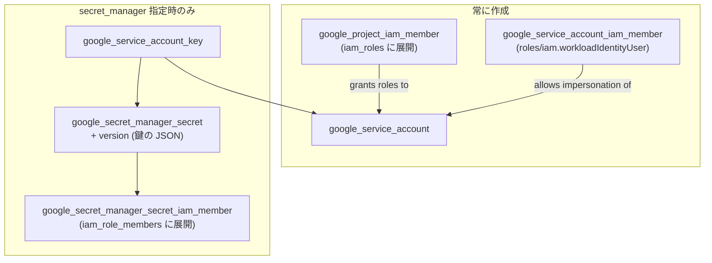

# Service Accounts Module

複数のサービスアカウントと、それぞれのプロジェクト IAM ロール・なりすまし許可
（Workload Identity）・（必要な場合のみ）キーの Secret Manager 保存をまとめて宣言します。

## なぜこのモジュールを使うのか

サービスアカウントを 1 つ用意するだけでも、実際には
「アカウント本体」「プロジェクトへのロール付与」「他アカウントからのなりすまし許可」の
3 種類のリソースを、ロールやメンバーの数だけ書くことになります。
5 つのサービスアカウントに 3 つずつロールを付ければ 20 リソースです。

このモジュールは、サービスアカウントを 1 つのオブジェクトとして宣言するだけで、
ロールとメンバーの直積への展開を自動で行います。`account_id` 以外はすべて省略可能なので、
「名前だけのサービスアカウント」から「キーを Secret Manager に保存する外部連携用アカウント」まで
同じ書き方で扱えます。

## 構成リソース



## 使い方

利用パターンの詳細・プライベートリポジトリの認証・アップグレード手順は
[docs/module_usage.md](../../../docs/module_usage.md) を参照してください。

### パターン A: GitHub 参照

```hcl
module "service_accounts" {
  source = "git::https://github.com/brainpad-whiterabbit/terraform-modules.git//modules/google/service-accounts?ref=v1.0.0"

  environment = {
    project_id = "my-project-id"
  }

  service_accounts = [
    {
      account_id   = "app-runner"
      display_name = "Application Runner"
      iam_roles = [
        "roles/secretmanager.secretAccessor",
        "roles/cloudsql.client",
      ]
    },
  ]
}
```

### パターン B: コピー＆ペースト

`modules/google/service-accounts` をディレクトリごと案件リポジトリの `modules/service-accounts`
にコピーし、ローカルパスで参照します。変数はパターン A と完全に同じです。

```hcl
module "service_accounts" {
  source = "./modules/service-accounts"

  environment = {
    project_id = "my-project-id"
  }

  service_accounts = [
    {
      account_id = "app-runner"
      iam_roles  = ["roles/cloudsql.client"]
    },
  ]
}
```

### フル構成の例

```hcl
module "service_accounts" {
  source = "git::https://github.com/brainpad-whiterabbit/terraform-modules.git//modules/google/service-accounts?ref=v1.0.0"

  environment = {
    project_id = "my-project-id"
  }

  service_accounts = [
    # 1. Cloud Run のランタイム用。名前とロールだけ。
    {
      account_id   = "app-runner"
      display_name = "Application Runner"
      description  = "Runs the application on Cloud Run"
      iam_roles = [
        "roles/secretmanager.secretAccessor",
        "roles/cloudsql.client",
      ]

      # CI のサービスアカウントからのなりすましを許可する
      # ('serviceAccount:' 接頭辞は省略可能)
      wi_user_service_accounts = [
        "github-actions@my-project-id.iam.gserviceaccount.com",
      ]
    },

    # 2. 外部 SaaS 連携用。Workload Identity が使えないためキーを発行する。
    {
      account_id   = "external-system"
      display_name = "External System Integration"
      iam_roles    = ["roles/storage.objectViewer"]

      secret_manager = {
        secret_id = "external-system-key"
        labels    = { managed_by = "terraform" }

        # 鍵を取り出せるメンバー
        iam_role_members = {
          "roles/secretmanager.secretAccessor" = [
            "group:ops@example.com",
          ]
        }
      }
    },
  ]
}

# 出力の使い方
module "api" {
  source = "git::https://github.com/brainpad-whiterabbit/terraform-modules.git//modules/google/cloud-run-service?ref=v1.0.0"

  environment = { project_id = "my-project-id", region = "asia-northeast1" }

  service = {
    service_name          = "api"
    image                 = "asia-northeast1-docker.pkg.dev/my-project-id/app/api:v1"
    service_account_email = module.service_accounts.service_account_emails["app-runner"]
  }
}
```

## Inputs

| Name | Description | Type | Default | Required |
|------|-------------|------|---------|:--------:|
| environment | 環境設定。 | `object` | n/a | yes |
| service_accounts | 作成するサービスアカウントのリスト。 | `list(object)` | n/a | yes |

### `environment`

| Name | Description | Type | Default | Required |
|------|-------------|------|---------|:--------:|
| project_id | デプロイ先の Google Cloud プロジェクト ID。 | `string` | n/a | yes |
| project_name | プロジェクト名。このモジュールでは未使用。 | `string` | `null` | no |
| region | リージョン。このモジュールでは未使用。 | `string` | `null` | no |
| stack_name | スタック名。このモジュールでは未使用。 | `string` | `null` | no |

### `service_accounts[*]`

| Name | Description | Type | Default | Required |
|------|-------------|------|---------|:--------:|
| account_id | サービスアカウント ID（6〜30 文字、小文字英数字とハイフン）。 | `string` | n/a | yes |
| display_name | 表示名。 | `string` | `null` | no |
| description | 説明。 | `string` | `null` | no |
| iam_roles | プロジェクトレベルで付与する IAM ロール。 | `list(string)` | `[]` | no |
| wi_user_service_accounts | `roles/iam.workloadIdentityUser` を付与するメンバー。`serviceAccount:` 接頭辞は省略可能。 | `list(string)` | `[]` | no |
| secret_manager | 指定するとキーを発行して Secret Manager に保存する。 | `object` | `null` | no |

### `service_accounts[*].secret_manager`

| Name | Description | Type | Default | Required |
|------|-------------|------|---------|:--------:|
| secret_id | 鍵を保存する Secret Manager シークレットの ID。全体で一意。英大小文字・数字・`-`・`_` のみ、255 文字以内。 | `string` | n/a | yes |
| labels | シークレットに付けるラベル。 | `map(string)` | `{}` | no |
| iam_role_members | シークレットに付与するロール => メンバーのマップ。 | `map(list(string))` | `{}` | no |

## Outputs

| Name | Description |
|------|-------------|
| service_accounts | account_id => サービスアカウントのリソース。 |
| service_account_emails | account_id => メールアドレス。 |
| service_account_names | account_id => 完全修飾名 (`projects/../serviceAccounts/..`)。 |
| service_account_ids | account_id => 一意な数値 ID (`unique_id`)。 |
| service_account_members | account_id => `serviceAccount:<email>` 文字列。 |
| key_secret_ids | account_id => キーを保存したシークレット ID。 |
| key_secret_names | account_id => キーを保存したシークレットの完全修飾名。 |

## Requirements

| Name | Version |
|------|---------|
| terraform | >= 1.10 |
| google | >= 6.0.0, < 8.0.0 |
| google-beta | >= 6.0.0, < 8.0.0 |

## Notes

> [!WARNING]
> **`secret_manager` はサービスアカウントキー（長期の静的認証情報）を発行します。**
> 発行された秘密鍵は Secret Manager に保存されるだけでなく、**Terraform の state にも
> 平文で残ります**。鍵の漏洩はプロジェクトへの永続的なアクセスにつながるため、
> Workload Identity 連携（GitHub Actions なら [github-oidc](../github-oidc) モジュール、
> GKE なら `wi_user_service_accounts`）が使える場合は**必ずそちらを使ってください**。
> `secret_manager` は、鍵ファイルしか受け付けない外部 SaaS との連携など、
> 他に手段がない場合の逃げ道です。
>
> 使う場合は最低限、state のバックエンドを暗号化しアクセスを制限すること、
> `iam_role_members` で鍵を読めるメンバーを絞ること、定期的にローテーションすることを行ってください。

- `iam_roles` の for_each キーは `"<account_id>_<role>"` です。ロール文字列を変更すると、
  該当バインディングは削除 → 再作成になります（ロール自体は冪等なため実害はありません）。
- IAM は authoritative でない `google_project_iam_member` / `google_secret_manager_secret_iam_member`
  を使っています。このモジュールの管理外で付与されたバインディングは削除されません。
- このモジュールは `google-beta` プロバイダーを使用します（Secret Manager 部分）。
  ルートモジュールで `google-beta` の `provider` ブロックも設定してください。
- キーのローテーションは自動では行われません。`terraform taint`（または
  `terraform apply -replace`）で `google_service_account_key.main["<account_id>"]` を
  置き換えると、新しい鍵が発行され Secret Manager に新バージョンとして保存されます。
