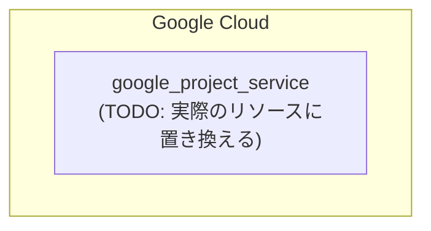

# __MODULE_TITLE__ Module

TODO: このモジュールが何を作るのかを 1〜2 文で書く。

## なぜこのモジュールを使うのか

TODO: 素の `resource` で書いた場合に何が面倒／危険なのかを書き、このモジュールが
それをどう解決するかを示す。ここが薄いモジュールは、そもそも作る価値があるかを
再検討すること（[module_contribution_guidelines.md](../../../docs/module_contribution_guidelines.md)）。

- TODO: 手で書くと忘れがちな設定・付与順序・排他制約
- TODO: このモジュールが肩代わりすること

## 構成リソース



## 使い方

利用パターンの詳細・プライベートリポジトリの認証・アップグレード手順は
[docs/module_usage.md](../../../docs/module_usage.md) を参照してください。

### パターン A: GitHub 参照

```hcl
module "__MODULE_SNAKE__" {
  source = "git::https://github.com/kotaitos/terraform-modules.git//__MODULE_PATH__?ref=main"

  environment = {
    project_id = "my-project-id"
  }

  __MODULE_SNAKE__ = {
    services = ["run.googleapis.com"]
  }
}
```

### パターン B: コピー＆ペースト

```hcl
module "__MODULE_SNAKE__" {
  source = "./modules/__MODULE_NAME__"

  # 変数はパターン A と完全に同じ
  environment = {
    project_id = "my-project-id"
  }

  __MODULE_SNAKE__ = {
    services = ["run.googleapis.com"]
  }
}
```

### フル構成

```hcl
module "__MODULE_SNAKE__" {
  source = "git::https://github.com/kotaitos/terraform-modules.git//__MODULE_PATH__?ref=main"

  environment = {
    project_id   = "my-project-id"
    project_name = "my-project"
    region       = "asia-northeast1"
    stack_name   = "my-stack"
  }

  __MODULE_SNAKE__ = {
    services = [
      "run.googleapis.com",
      "artifactregistry.googleapis.com",
    ]
    disable_on_destroy = true
  }
}
```

## Inputs

| Name | Description | Type | Default | Required |
|------|-------------|------|---------|:--------:|
| environment | 環境設定。 | `object` | n/a | yes |
| __MODULE_SNAKE__ | __MODULE_NAME__ の設定。 | `object` | n/a | yes |

### `environment`

| Name | Description | Type | Default | Required |
|------|-------------|------|---------|:--------:|
| project_id | デプロイ先の Google Cloud プロジェクト ID。 | `string` | n/a | yes |
| project_name | プロジェクト名。このモジュールでは未使用（他モジュールとの互換のため受け取る）。 | `string` | `null` | no |
| region | リージョン。このモジュールでは未使用。 | `string` | `null` | no |
| stack_name | スタック名。このモジュールでは未使用。 | `string` | `null` | no |

### `__MODULE_SNAKE__`

| Name | Description | Type | Default | Required |
|------|-------------|------|---------|:--------:|
| services | 有効化する Google Cloud API のリスト。 | `list(string)` | n/a | yes |
| disable_on_destroy | `terraform destroy` 時に API を無効化するか。 | `bool` | `false` | no |

## Outputs

| Name | Description |
|------|-------------|
| services | 有効化した Google Cloud API のリスト。 |
| project_id | リソースを作成した Google Cloud プロジェクト ID。 |

## Requirements

| Name | Version |
|------|---------|
| terraform | >= 1.10 |
| google | >= 6.0.0, < 8.0.0 |

## Notes

- TODO: 制約・前提・落とし穴を書く。特に以下は必ず書く。
  - `deletion_protection` のように、削除時に追加操作が必要なもの
  - state に平文で保存される機密情報
  - authoritative な IAM リソースを使っている場合の副作用
  - `lifecycle.ignore_changes` の対象と、その結果 Terraform が検知しない変更
